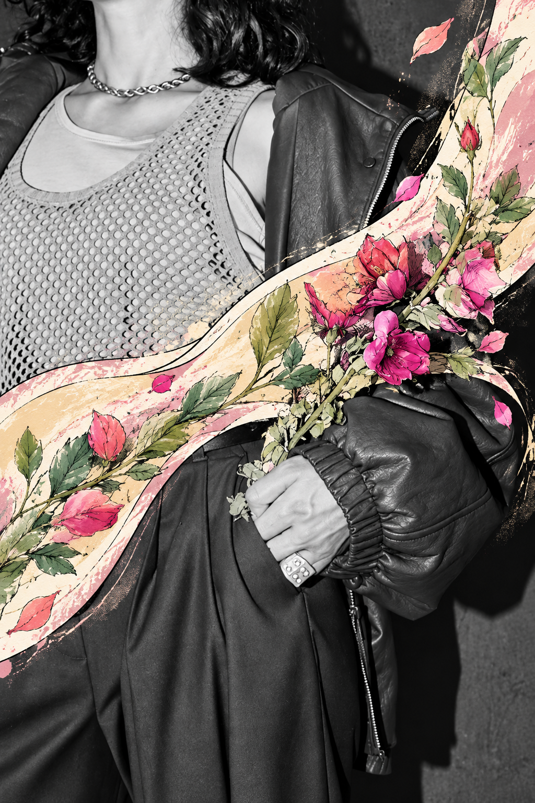
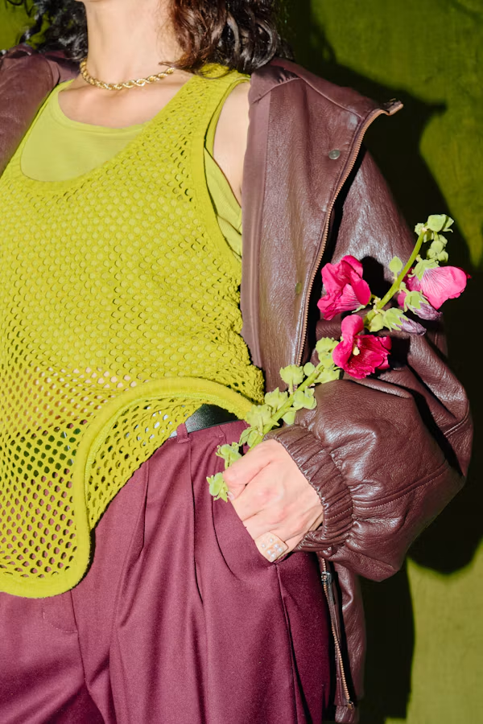
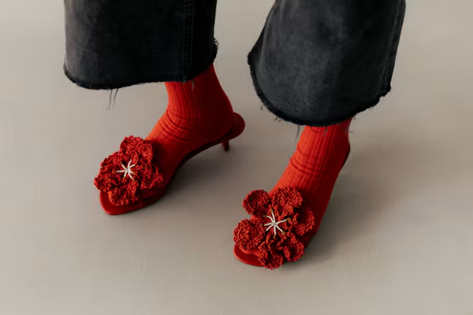
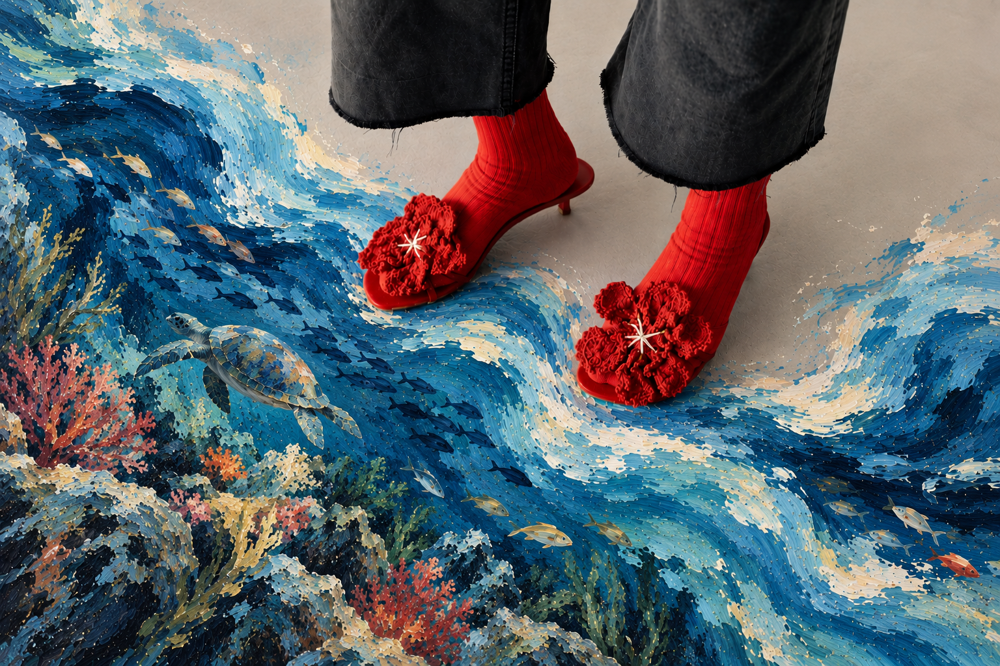
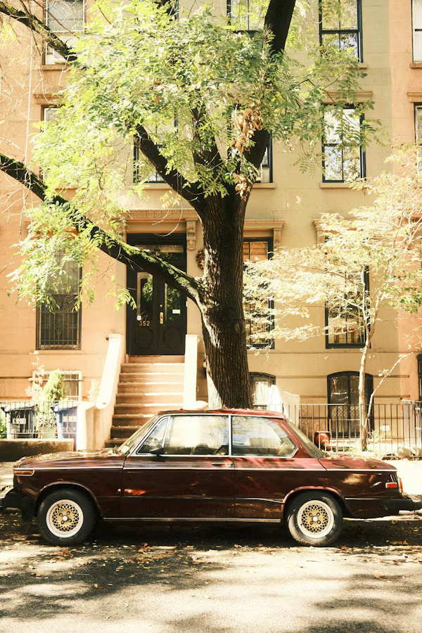
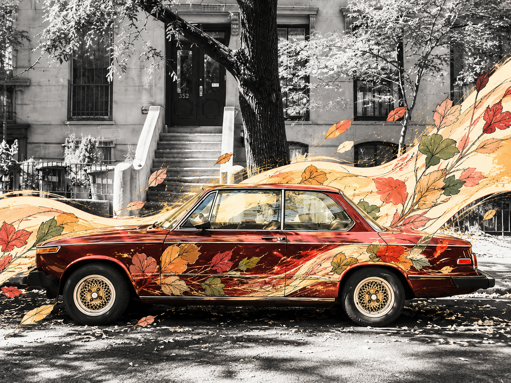
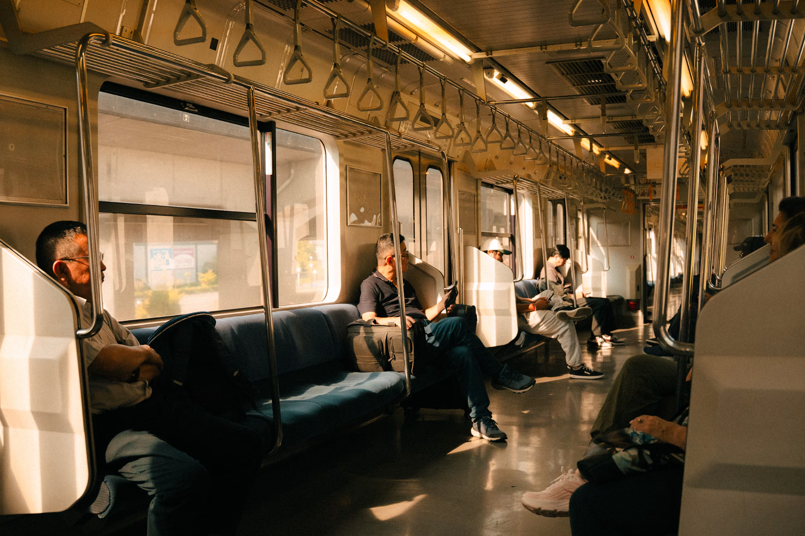
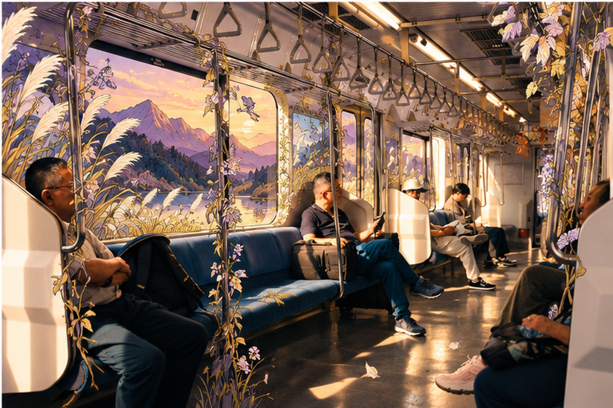
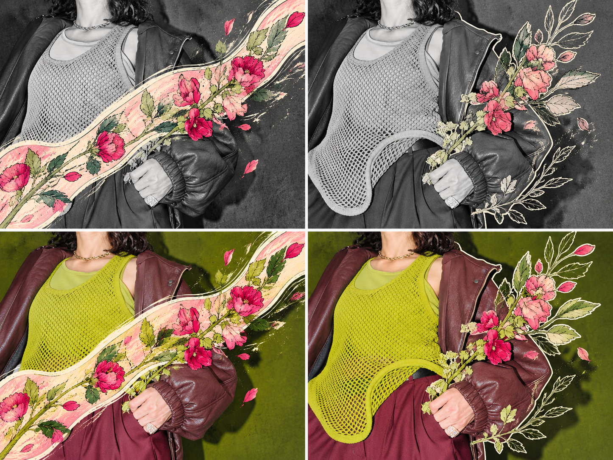

# Photo Art Remix

Keep the realism of a photograph while turning a deliberately shaped region into illustration.

Photo Art Remix is a reusable **AI image-editing workflow skill** for photo grading, region planning, artistic treatment, and visual review. It requires an AI platform with image understanding and editing capabilities; it does not include an image model, API service, or standalone photo editor.



## The three-step workflow

| Step | Purpose | Available approaches |
| --- | --- | --- |
| 1. Grade the photograph | Build comfortable tonal relationships and preserve recognizable materials | Soft monochrome, clear grayscale, high-key or low-key black and white, warm or cool gray, muted color, original color |
| 2. Plan the art region | Define its position, shape, direction, coverage, and protected areas before generating | Straight or diagonal bands, curved ribbons, broad brush strokes, dry-brush bands, irregular or torn-paper shapes, circular or elliptical windows, geometric slices, object silhouettes |
| 3. Apply the artistic treatment | Translate content inside the region into the chosen medium, with restrained supporting elements | Hand-drawn outlines, continuous lines, structural linework, doodles, flat illustration, collage, watercolor, printmaking, oil-paint effects |

The region needs a readable interior, rather than just an outline or selective color. Added elements should relate to the photograph without multiplying the subject or competing with its original focal point.

## Quick start

### In an AI chat or project

1. Attach [photo-art-remix-universal.md](photo-art-remix-universal.md) and ask the AI to read the complete workflow.
2. Upload the photograph you want to edit. Label additional images as style references.
3. Describe your request, for example:

```text
Use the attached workflow to edit this photo. Choose several suitable combinations
and generate each result as a separate image.
```

For repeated use, add the workflow to your project's shared files and copy [project-instructions.txt](project-instructions.txt) into its instructions. Shared-file support and image-editing features depend on the platform. The workflow files are currently written in Chinese; this README and its example requests are in English.

### In a tool that supports skill folders

Copy the [photo-art-remix](photo-art-remix) folder into the custom skill location supported by your tool. Preserve its structure:

```text
photo-art-remix/
├── SKILL.md
├── agents/
│   └── openai.yaml
└── references/
    ├── composition.md
    └── styles.md
```

[SKILL.md](photo-art-remix/SKILL.md) is the entry point. Supporting references are loaded as needed. `agents/openai.yaml` provides optional interface metadata for compatible tools; it is not required to follow the workflow. Use the single-file edition when skill folders are unsupported.

## Output count and variations

| Request | Expected behavior |
| --- | --- |
| "Process this photo" or "Random effects" | Plan four suitable variations and generate four separate images |
| "One random version" or "Two random versions" | Use the requested count |
| "Watercolor, all black and white" | Keep those choices fixed and select the remaining techniques; one image unless a count is requested |
| "Several versions, all black and white" | Four monochrome versions with different regions or artistic treatments |
| "Make this result lighter" | Edit that result without automatically expanding it into four versions |
| "Use the classic default" | Soft monochrome, a region selected for the composition, and hand-drawn lines with limited color fields; one image |
| "Use the original four combinations" | Monochrome/original color crossed with curved ribbon/object silhouette |

Automatic variation still requires region planning and subject protection. Choose compatible grading, geometry, medium, palette, and supporting elements instead of simply recoloring the same composition. Explicit user choices take priority.

**Multiple results are separate images, not a four-panel collage.** If the platform cannot finish every image, it should report the actual count. Combine images only when the user requests a comparison board or collage.

## Examples

These existing results illustrate different directions; they are not a cross-platform reliability benchmark for the current rules. Results depend on the source photo, instruction following, and the image model. Images retain their original aspect ratios; different source compositions are not cropped to match.

### Fashion and flowers: monochrome with a hand-drawn ribbon

<table>
  <tr><th>Original</th><th>Artistic result</th></tr>
  <tr>
    <td width="50%" valign="top"></td>
    <td width="50%" valign="top"></td>
  </tr>
</table>

### Footwear: an ocean-inspired art region

<table>
  <tr><th>Original</th><th>Artistic result</th></tr>
  <tr>
    <td width="50%" valign="top"></td>
    <td width="50%" valign="top"></td>
  </tr>
</table>

### Street scene: an autumn ribbon around a classic car

<table>
  <tr><th>Original</th><th>Artistic result</th></tr>
  <tr>
    <td width="50%" valign="top"></td>
    <td width="50%" valign="top"></td>
  </tr>
</table>

### Train interior: twilight mountains and illustrated window details

<table>
  <tr><th>Original</th><th>Artistic result</th></tr>
  <tr>
    <td width="50%" valign="top"></td>
    <td width="50%" valign="top"></td>
  </tr>
</table>

<details>
<summary>View an earlier comparison of treatment styles</summary>



This historical comparison board illustrates different treatments. It does not change the current requirement to deliver multiple versions as separate images.

</details>

## Example adjustments

```text
Generate only one image. Keep the original colors and use a curved ribbon.
```

```text
Generate two random versions. Protect the face, use fewer supporting elements,
and keep the linework light.
```

```text
Keep the current grading and region. Change only the treatment inside it to watercolor.
```

```text
Preserve the original focal point. Reduce repeated subjects and add a little related
texture. Do not add people.
```

## Files and privacy

- The workflow does not require a specific model, tool name, operating system, local directory, or credential. Region planning does not imply precise masking support.
- Published examples use neutral filenames and contain no EXIF or other embedded image metadata. Their pixel content is unchanged.
- The repository includes rules, project instructions, and selected examples. It excludes personal chat transcripts, debug prompts, historical backups, local paths, and credentials.
- This repository contains no upload service or telemetry code. Your source images are supplied through the AI platform you choose.

Generative editing can alter details outside the intended region. Review the actual result for subject identity, region shape, focal hierarchy, medium, and image count; pixel-perfect preservation is not guaranteed.

## Repository layout

```text
.
├── README.md
├── photo-art-remix/             # Standard skill folder
├── photo-art-remix-universal.md # Complete single-file workflow for AI chats
├── project-instructions.txt    # Reusable project instructions
└── examples/                   # Original photographs and artistic results
```

When suggesting an improvement, include the issue, the intended result, and an example suitable for sharing. Do not include credentials or private chat content.
